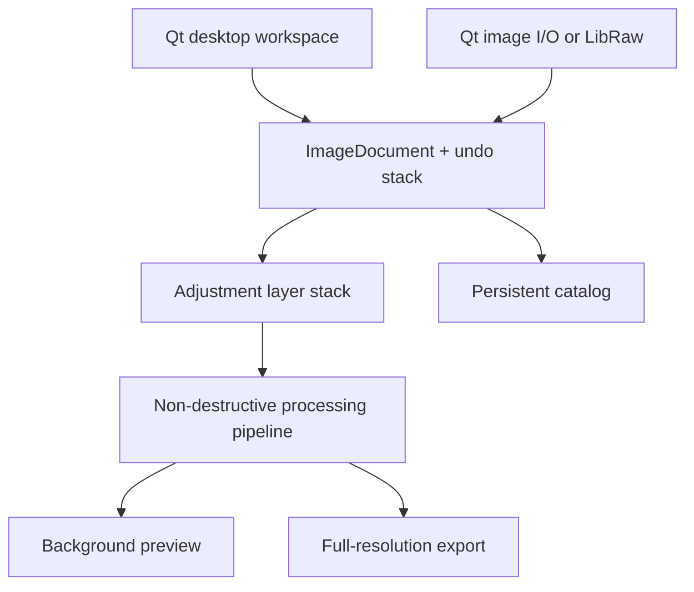
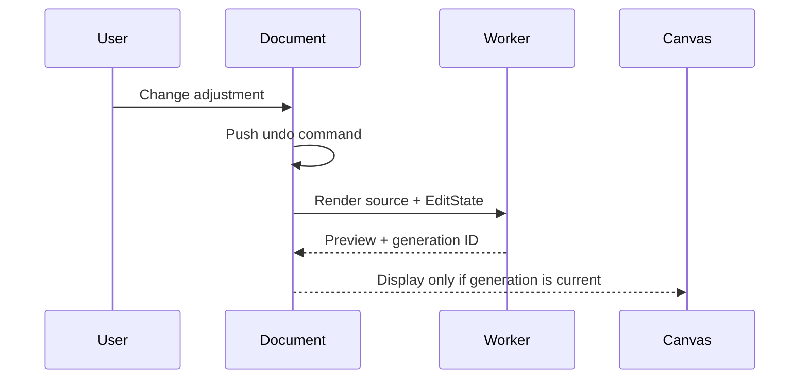

# ChromaDesk Architecture

## Design principles

1. **Never modify the source photograph.** Every action produces an `EditState`.
2. **Keep interaction responsive.** Preview decoding and rendering run outside
   the UI thread; stale renders are discarded by generation number.
3. **Use one shared product codebase.** Platform differences are isolated in
   deployment rather than editor behavior.
4. **Keep the MVP replaceable at its seams.** The catalog, decoder, renderer,
   and export path can evolve independently.

## Main components

| Component | Responsibility |
| --- | --- |
| `Catalog` | File references, ratings, flags, edit-state persistence, atomic saves |
| `ImageLoader` | Standard image decoding, orientation, ICC-to-sRGB conversion, optional RAW decoding |
| `EditState` | Serializable, bounded non-destructive edit recipe |
| `LayerStack` | Ordered adjustment layers with identity, name, visibility, opacity and per-layer edit values |
| `LayerMask` | Serializable AI, range, and shape-mask recipes with feathering |
| `RetouchOperation` | Serializable local heal/clone coordinates and generated-image references |
| `TextOverlay` | Serializable text-layer content, typography, colour and placement |
| `WatermarkOverlay` | Serializable text/image watermark content, styling, opacity, size and free placement |
| `AppleVisionMaskEngine` | Native macOS 14+ foreground-instance segmentation behind an isolated platform boundary |
| `SmartMaskEngine` | Cached native foreground masks, portable fallback, connected-sky selection, and deterministic color/luminance/shape masks |
| `ImageProcessor` | Crop/orientation, tonal/color/replacement/blur transforms, local heal/clone sampling, generated-image composition, watermark/text drawing, border composition and per-pixel masking |
| `PassportSheet` | 35 × 45 mm centre crop and 300 DPI 4 × 6/A4 print-sheet composition |
| `PresetRepository` | Five quick presets and 50 categorized creative filter recipes |
| `ImageDocument` | Active image lifecycle, asynchronous preview rendering, undo/redo |
| `ImageCanvas` | Fit/zoom/pan, comparison views, active-layer mask visualization, draggable guides, interactive crop, shape selection, spot healing and two-click clone placement |
| `GenerativeFillClient` | Consent-gated multipart Image API edit request and base64 PNG response decoding |
| `ThemeManager` | Persistent Gray, High Contrast, and Colorful application themes |
| `MainWindow` | Product workflow, branded version header, configurable library views, six-tab Develop panel, preferences, metadata and export orchestration |

## Render flow

Slider changes with the same adjustment and layer ID merge into a single undo command.
The worker receives implicitly shared `QImage` data and a value-copy of the edit
recipe. It cannot mutate either the document state or the source pixels.

## Catalog format

The current catalog is an atomic JSON document in the OS application-data
folder. Each item contains an absolute source path, import timestamp, rating,
pick state, and serialized layer stack. Version 1 edit recipes migrate into the
Base Adjustments layer automatically. `QSaveFile` replaces the previous catalog only
after a complete write.

For production-scale libraries, replace this implementation with SQLite in WAL
mode, schema migrations, content hashes, offline/missing-file reconciliation,
and transactional thumbnail/edit caches. The public `Catalog` boundary keeps
that migration local.

## Color and RAW

Standard files are decoded through `QImageReader`. Valid embedded profiles are
converted to sRGB; untagged images are assigned sRGB. LibRaw reads camera RAW
bytes from memory, applies camera white balance, and provides an sRGB bitmap to
the MVP pipeline.

The production engine should preserve camera-linear 16-bit data, use explicit
input/display/output transforms, and apply operations in a scene-linear or
perceptually appropriate working space. The current 8-bit pipeline is an MVP
tradeoff, not the intended ceiling.

## Layer composition

The Base Adjustments layer owns global orientation and crop. All visible layers
are then evaluated bottom-to-top. Each layer's tonal, colour and blur result is
mixed with the previous result using its opacity multiplied by the generated
mask coverage. Subject/background/sky masks are regenerated from the oriented image;
range and shape masks are generated from their persisted parameters. Text and
watermark overlays are then drawn in layer order using the same visibility and
opacity controls. The Base Adjustments border is composed once around the final
layer result, so it remains outside every photographic and overlay layer.
Layer values remain independently
editable and the full stack participates in undo/redo, preview rendering,
catalog persistence, and full-resolution export.

Heal and Clone layers store normalized source/target coordinates and brush
radius. The processor samples from the prior layer result and applies a soft
circular edge. A Generative Fill layer stores the returned PNG in per-user app
data and composites it through its persisted rectangle mask, so visibility,
opacity, ordering, feathering, undo/redo and export use the normal layer path.

Creative filters use the same `EditState` values as manual adjustments. Applying
a filter adds a global adjustment layer instead of changing an existing layer,
so users can tune its sliders, opacity, visibility, order, and mask afterward.

The active-layer tint, broken mask boundary, rulers, composition grids, and
user-created guides are canvas-only presentation state. None is passed to
`ImageProcessor`, which guarantees that those aids never appear in output files.

## Security and resilience

- Source files are opened read-only.
- Catalog writes use atomic replacement.
- JSON fields are bounded before entering the processing engine.
- Save/export and passport-sheet workflows are the only paths that write image
  pixels, and each requires an explicit destination.
- All third-party dependencies are supplied through normal package mechanisms;
  none are downloaded or executed by the application.
- Smart masks, Dust Heal, and Clone Stamp run locally and do not upload pixels.
- Generative Fill is opt-in. After an explicit notice it sends a resized edit,
  transparent area mask, and prompt to OpenAI. Its API key is kept in process
  memory only and cleared after an error or app exit.
- Release signing/notarization credentials remain outside the repository.
